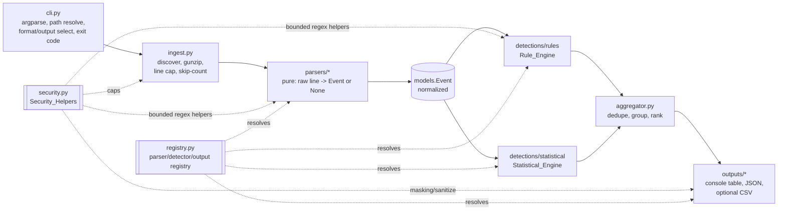
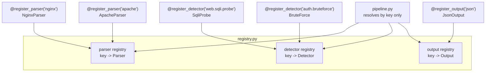

# Design Document

## Overview

`loganalyze` is a batch command-line tool that ingests system and web-server logs,
recognizes known-attack signatures and statistical anomalies, and renders
explainable, safely-sanitized findings. This design realizes the v1 requirements in
`requirements.md` and is bound by the steering files in `.kiro/steering/`.

The design maps to the steering documents as follows:

- **product.md** — batch execution model, read-only input, exit-code-driven
  composition, the in-scope log families (nginx, Apache, syslog, `auth.log`), and
  hybrid rule + statistical detection. Non-goals (streaming, external alert sinks,
  ML, offensive tooling) are honored as hard boundaries and called out in the
  future-extension note.
- **tech.md** — Python 3.10+, standard-library-only core (`argparse`, `logging`,
  `re`, `statistics`, `json`, `csv`, `pathlib`, `dataclasses`, `enum`,
  `collections`). The `loganalyze[stats]` accelerated extra is **future work** and
  is not designed into v1; no `numpy`/`pandas` appears in any core path.
- **structure.md** — the `ingest → parse → normalized Event → detect
  (rules + statistical) → aggregate → output` pipeline, the directory layout, and
  the parser/detector/output plugin pattern registered via decorators in
  `registry.py` so that adding a plugin requires no pipeline edits.
- **security.md** — binding, non-negotiable rules: line caps before regex,
  precompiled bounded ReDoS-safe regexes, no dynamic code execution on log-derived
  data, control-character stripping, CSV formula neutralization, atomic/restrictive
  file writes with canonical path resolution, refusal of log-derived output paths,
  and PII/secret masking at the output boundary. These live in a shared
  `Security_Helpers` module (`security.py`) used by ingest, detections, and
  outputs.
- **detection-rules.md** — the normalized `Event` schema, the `Severity`
  enumeration, the explainable `Finding` shape, and the catalog of rule and
  statistical detections. The data models in this design reproduce those schemas
  exactly.
- **coding-conventions.md** — modern type hints, docstrings, module-level loggers,
  pure parsers and pure detectors, injected configuration.
- **testing-standards.md** — pytest, TDD, synthetic-only fixtures, positive and
  false-positive coverage per detector, and direct validation of the stdlib
  `statistics` path. This design adds property-based tests for the correctness
  properties below.

### Design goals

1. **One contract, many plugins.** Every parser emits the same `Event`; every
   detector consumes `Event`s and yields `Finding`s; every output renders
   `Finding`s. New formats and detections are new modules, not pipeline edits.
2. **Untrusted by default.** Every byte of every log is attacker-influenced. Caps
   and sanitization are centralized so no component can forget them.
3. **Explainable findings.** Each `Finding` carries `detail` and `metadata` that
   say what matched and why.
4. **Deterministic output.** Identical inputs always produce identically ordered
   output, which makes the tool testable and diff-friendly.

## Architecture

### Pipeline flow

A single invocation flows strictly left to right and terminates when the finite
input set is consumed (product non-goal: no streaming, no daemon).



### Plugin / registry pattern

Parsers, detectors, and outputs are plugins behind a `Protocol` in their package's
`base.py`. `registry.py` holds three independent registries keyed by short
lowercase identifiers, populated by decorators at import time. `pipeline.py`
resolves plugins by key and never names a concrete plugin class, so adding a format
or detection means adding one module and registering it — no pipeline edits
(Requirements 3.10, 5.9, 8.14).



Registration into an already-occupied key raises a `RegistryConflictError` rather
than silently overriding (Requirement 3.11).

### Package layout

The layout follows `structure.md` exactly:

```
src/loganalyze/
  cli.py          ingest.py      models.py     registry.py    pipeline.py
  security.py     aggregator.py  config.py
  parsers/        base.py nginx.py apache.py syslog.py authlog.py
  detections/     base.py
      rules/      engine.py signatures/
      statistical/engine.py zscore.py rate_spike.py rare_event.py
  outputs/        base.py console.py file_json.py file_csv.py
```

`config.py` is added to hold the frozen configuration dataclasses described under
Data Models; it carries no logic beyond defaults and validation.

## Components and Interfaces

All signatures use modern typing and `from __future__ import annotations`. Every
public module, class, and function carries a docstring per `coding-conventions.md`.

### models.py — shared contract

See Data Models for the full `Event`, `Finding`, and `Severity` definitions. These
are the only types crossing component boundaries.

### registry.py — plugin registration

```python
from __future__ import annotations
from typing import TypeVar, Callable

class RegistryConflictError(Exception):
    """Raised when two plugins register under the same key."""

_PARSERS: dict[str, type["Parser"]] = {}
_DETECTORS: dict[str, type["Detector"]] = {}
_OUTPUTS: dict[str, type["Output"]] = {}

def register_parser(key: str) -> Callable[[type["Parser"]], type["Parser"]]:
    """Register a Parser class under ``key``; raise on duplicate key."""

def register_detector(key: str) -> Callable[[type["Detector"]], type["Detector"]]:
    """Register a Detector class under ``key``; raise on duplicate key."""

def register_output(key: str) -> Callable[[type["Output"]], type["Output"]]:
    """Register an Output class under ``key``; raise on duplicate key."""

def get_parsers() -> dict[str, "Parser"]: ...
def get_parser(key: str) -> "Parser | None": ...
def get_detectors() -> dict[str, "Detector"]: ...
def get_outputs() -> dict[str, "Output"]: ...
```

Each registry decorator checks membership before insertion and raises
`RegistryConflictError` on conflict (Requirement 3.11). Accessors instantiate the
registered classes (parsers/detectors/outputs are stateless or config-injected).

### parsers/base.py — Parser protocol

```python
from __future__ import annotations
from typing import Protocol, runtime_checkable
from loganalyze.models import Event

@runtime_checkable
class Parser(Protocol):
    """Pure converter from one raw log line to a normalized Event."""

    log_type: str  # registry key; set on every Event this parser emits

    def parse(self, raw_line: str) -> Event | None:
        """Parse one raw line into an Event, or return None if it does not match.

        Must be a pure function of ``raw_line``: no I/O, no mutable global
        state, no exceptions on malformed input (return None instead).
        """
```

Concrete parsers (`nginx`, `apache`, `syslog`, `authlog`, Requirement 3.12) each
own one precompiled, bounded regex at module import (Requirement 9.1). On a
non-match or malformed line they return `None` and never raise (Requirements 3.4,
3.5). Absent optional fields are set to `None` (Requirement 3.2); `log_type` equals
the registry key (Requirement 3.3). Timestamp normalization lives in a shared
helper (below) so all parsers behave identically.

### Timestamp normalization helper

A shared pure helper in `models.py` (or a small `timeutil.py`) centralizes
Requirements 3.7–3.9:

```python
def normalize_timestamp(raw: str, fmt: str) -> tuple[datetime, bool]:
    """Parse a timestamp string.

    Returns (dt, aware) where ``aware`` is True when the source carried an
    explicit offset or Z (converted to UTC) and False when the source was naive
    (recorded as a local datetime with no offset applied).
    """
```

The pipeline tracks whether any run produced both aware and naive events and emits
a single mixed-timezone warning via `logging` when so (Requirement 3.9).

### ingest.py — input discovery and safe line iteration

```python
from __future__ import annotations
from dataclasses import dataclass
from pathlib import Path
from collections.abc import Iterator

@dataclass(frozen=True)
class LineRecord:
    """One raw line with provenance, before parsing."""
    source: str
    line_number: int
    raw_line: str
    truncated: bool

class IngestError(Exception):
    """Non-fatal-to-run ingest problem (bad gzip, unreadable file)."""

def discover_inputs(paths: list[Path]) -> list[Path]:
    """Resolve each path: a file yields itself; a directory is walked
    recursively for regular files. Raises on a path that does not exist."""

def iter_lines(path: Path, max_line_bytes: int) -> Iterator[LineRecord]:
    """Yield LineRecords for one file in ascending line order from 1.

    Transparently decompresses gzip input; reads plaintext directly. Enforces
    ``max_line_bytes`` BEFORE any regex: an over-long line is truncated to the
    cap, flagged truncated=True, and (by pipeline policy) skipped and counted.
    """
```

Gzip is detected by magic bytes (`1f 8b`), not file extension. A failed
decompression raises `IngestError`, which the pipeline logs and then continues with
the next file (Requirement 2.8). `iter_lines` preserves source and ascending line
numbers starting at 1 (Requirements 2.1, 2.9). The cap is applied on the raw
`bytes`/`str` length before any parser regex touches the line (Requirements 2.4,
2.5, 9.4). Reads are open-for-read only; nothing writes to input files
(Requirement 1.12).

### Skip counting

The pipeline owns a `SkipCounter` tallying skipped lines by reason:

```python
@dataclass
class SkipCounter:
    """Per-run tally of skipped lines, counted at most once each."""
    truncated: int = 0
    unparseable: int = 0

    @property
    def total(self) -> int:
        return self.truncated + self.unparseable
```

A truncated line is counted once with reason `truncated` and is **not** offered to
parsers (Requirements 2.5, 4.5, 9.4). A line that every applicable parser rejects
is counted once as `unparseable` (Requirements 4.1, 4.2). Neither is fatal
(Requirements 4.6, 10 non-goals unaffected). The totals reach output (Requirements
4.3, 4.4).

### pipeline.py — orchestration

```python
def run(config: RunConfig) -> RunResult:
    """Execute one batch run and return findings plus run statistics.

    Steps: discover inputs -> for each file, iterate capped lines ->
    select parser (override or auto-detect) -> parse to Events ->
    run Rule_Engine and Statistical_Engine -> aggregate -> return.
    Output rendering and exit-code selection are the CLI's job.
    """
```

**Format selection** (Requirements 1.5, 1.6): if `config.format_override` names a
registered parser, that parser is applied to all input. Otherwise the pipeline
auto-detects per input by sampling its first lines and choosing the first
registered parser (in a deterministic registry order) that returns a non-`None`
`Event`. An unknown override key is surfaced to the CLI as an error before ingest
(Requirement 1.7).

`RunResult` carries the aggregated findings, the `SkipCounter`, and a
`mixed_timezones: bool` flag.

### detections/base.py — Detector protocol

```python
@runtime_checkable
class Detector(Protocol):
    """Consumes Events (plus injected config) and yields Findings. Pure:
    no I/O, no alerting — side effects belong in outputs."""

    rule_id: str

    def detect(self, events: list[Event], config: DetectionConfig) -> list[Finding]:
        """Return zero or more Findings for the given events."""
```

#### Rule_Engine (`detections/rules/engine.py`)

Holds the registered signature detectors and runs each over the event list. v1
signatures (Requirement 5), each with a precompiled bounded ReDoS-safe regex or a
windowed threshold:

- `web.sqli.probe` — SQLi probe in web request `path` (HIGH). detail names the
  matched signature; metadata has `source`, `line_number`, `path` (5.1).
- `web.xss.probe` — XSS probe in web request `path` (HIGH) (5.2).
- `web.scanner.ua` — scanner user-agent in `fields["user_agent"]` (MEDIUM) (5.3).
- `auth.bruteforce` — ≥ `threshold` failed-auth events per `client_ip` within
  `window_seconds` (default 5 / 60s) (HIGH). metadata has `client_ip`, observed
  count, threshold, window (5.4, 5.10).
- `web.status_spike` — ≥ `threshold` error-status events within `window_seconds`
  (default 20 / 60s) (MEDIUM). metadata has count, threshold, window (5.5, 5.10).
- `auth.failed_login` — failed login in `auth.log` (LOW/MEDIUM). metadata has
  `client_ip`, `user`, `source`, `line_number` (5.6).
- `auth.privesc` — `sudo`/`su` escalation to root (HIGH). metadata has `user`,
  mechanism, `source`, `line_number` (5.7).

Each `Finding` carries exactly one `Severity` (5.8). Windowed detectors sort
contributing events by timestamp and slide a fixed window; the window is closed
and half-open deterministically so results do not depend on iteration order.

#### Statistical_Engine (`detections/statistical/engine.py`)

Pure stdlib `statistics` only; no `numpy`/`pandas`, no ML (Requirements 6.1, 6.8,
10.3). Two detectors:

- **Rate spike** (`zscore.py`, `rate_spike.py`): bucket events into fixed-duration
  `baseline_window_seconds` buckets (default 60s). Compute `mean` and `pstdev`;
  for each bucket, `z = (count - mean) / sigma`; flag buckets with
  `z >= z_threshold` (default 3.0, clamped to [1.0, 10.0]) (6.2, 6.3). Yield
  nothing when fewer than two buckets exist or `sigma == 0` (6.6).
- **Rare event** (`rare_event.py`): over a categorical series (e.g. status code,
  or user-on-host), compute relative frequency; flag values strictly below
  `rare_cutoff` (default 0.01, in the open interval (0.0, 1.0)) (6.4). Yield
  nothing when fewer than `min_observations` samples exist (6.7).

Every statistical `Finding` includes baseline value, observed value, score, and
threshold in `metadata` (6.5). `statistics.quantiles` is available for cutoff
tuning per detection-rules.md guidance.

### aggregator.py — dedupe, group, rank

```python
def aggregate(findings: list[Finding]) -> list[Finding]:
    """Merge duplicates, group by rule_id, and rank by severity.

    Findings sharing (rule_id, dedup_key) merge into one whose ``events`` is the
    union of contributing events. Output is ordered critical -> info, with a
    deterministic secondary sort (rule_id, then first-event (source, line)).
    """
```

The dedup key is derived per rule from the identifying `metadata` (e.g. `client_ip`
for brute force). Severity order is the fixed enumeration
`critical, high, medium, low, info` (Requirement 7.4); ties break on `rule_id` then
the earliest contributing event's `(source, line_number)` so identical inputs
always yield identical order (Requirements 7.3, 7.5, 7.6).

### outputs/base.py — Output protocol and Security_Helpers usage

```python
@runtime_checkable
class Output(Protocol):
    """Render findings to a destination. Applies Security_Helpers sanitization
    and masking at this boundary; raw sensitive values never reach disk."""

    def render(self, findings: list[Finding], target: OutputTarget) -> None:
        """Render findings to the configured destination."""
```

- `console.py` — terminal table to stdout; control characters stripped
  (Requirements 8.1, 8.4).
- `file_json.py` — atomic structured JSON file (8.2, 8.6).
- `file_csv.py` — optional CSV with formula neutralization (8.3, 8.5).

Every string placed into any output passes through `Security_Helpers` masking then
control-character stripping before rendering, so no raw unmasked secret/PII and no
forbidden control character reaches console or disk (Requirements 8.4, 8.7–8.10).

### security.py — Security_Helpers (shared)

The single home for the binding security rules, imported by ingest, detections, and
outputs (Requirement 9.5).

```python
from __future__ import annotations
import re

MAX_LINE_BYTES_DEFAULT = 65536  # 64 KiB

_CTRL = re.compile(r"[\x00-\x08\x0b-\x1f\x7f]")          # preserves \t
_FORMULA_PREFIXES = ("=", "+", "-", "@")

def cap_line(raw: str, max_line_bytes: int) -> tuple[str, bool]:
    """Return (line, truncated) enforcing the byte cap before any regex."""

def strip_control(text: str) -> str:
    """Replace control chars (except tab) with U+FFFD (Requirement 8.4)."""

def csv_safe(value: str) -> str:
    """Prefix an apostrophe when value starts with = + - @ (Requirement 8.5)."""

def mask_secret(value: str) -> str:
    """Mask credential-like values: <=4 chars fully masked; otherwise reveal
    at most first2 + last2 (Requirement 8.7)."""

def mask_email(value: str) -> str:
    """Reveal at most first char of local part + full domain (Requirement 8.8)."""

def mask_ip(value: str) -> str:
    """Reveal at most first 2 octets of a dotted-quad IP (Requirement 8.9)."""

def resolve_output_path(path: Path, *, log_derived: bool) -> Path:
    """Canonicalize to absolute real path; refuse log-derived paths
    (Requirements 8.11, 8.12)."""

def atomic_write(path: Path, data: str) -> None:
    """Write to a temp file with restrictive permissions and os.replace onto the
    destination; on failure remove the temp file and leave any existing
    destination unchanged, then raise (Requirements 8.6, 8.11, 8.13)."""
```

These functions are pure where possible and have direct unit tests per
`testing-standards.md`. No function here passes log-derived data to `eval`, `exec`,
`compile`, `pickle`, a shell, or a dynamic import (Requirement 9.3).

### cli.py — argument parsing and exit codes

```python
def main(argv: list[str] | None = None) -> int:
    """Parse args, build RunConfig, run the pipeline, render outputs, and return
    the process exit code."""
```

Uses `argparse` (Requirement 1.1). Accepts one or more input paths, optional
`--format`, output selection (`--report` JSON, optional `--csv`), and detection
config overrides (thresholds/windows/cutoffs/line cap). Validates config before
ingest (Requirements 2.7, 6.3 range, 6.4 range). Exit codes (Requirements 1.13,
1.14):

| Code | Meaning            |
|------|--------------------|
| 0    | clean run, no findings |
| 1    | findings produced  |
| 2    | error (usage, unknown format, bad path, unreadable, no input, invalid config, write failure) |

Skipped-line counts are reported in output (Requirement 4.3).

## Data Models

### Severity (`models.py`)

```python
from enum import IntEnum

class Severity(IntEnum):
    """Finding severity; ordering value drives ranking (critical highest)."""
    INFO = 0
    LOW = 1
    MEDIUM = 2
    HIGH = 3
    CRITICAL = 4
```

String forms `info, low, medium, high, critical` are the serialized representation
(Requirement 5.8, detection-rules.md). `IntEnum` gives a natural rank; the
aggregator sorts descending so `critical` leads (Requirement 7.4).

### Event (`models.py`)

Exactly the schema from detection-rules.md (Requirement 3.1–3.3):

```python
from dataclasses import dataclass, field
from datetime import datetime

@dataclass(frozen=True)
class Event:
    """Normalized record emitted by a Parser."""
    timestamp: datetime
    source: str
    log_type: str
    message: str
    raw: str
    fields: dict[str, str] = field(default_factory=dict)
    host: str | None = None
    client_ip: str | None = None
    user: str | None = None
    method: str | None = None
    path: str | None = None
    status: int | None = None
```

### Finding (`models.py`)

Exactly the schema from detection-rules.md (Requirement 7.1):

```python
@dataclass
class Finding:
    """Explainable detection result."""
    rule_id: str
    title: str
    severity: Severity
    events: list[Event]
    detail: str
    metadata: dict
```

### Configuration (`config.py`)

Frozen, injected into detectors (never read from env or files inside a detector,
per coding-conventions.md). Defaults match requirements exactly.

```python
@dataclass(frozen=True)
class IngestConfig:
    max_line_bytes: int = 65536          # Requirement 2.6 default

@dataclass(frozen=True)
class RuleConfig:
    brute_force_threshold: int = 5       # Requirement 5.4/5.10
    brute_force_window_seconds: int = 60
    status_spike_threshold: int = 20     # Requirement 5.5/5.10
    status_spike_window_seconds: int = 60

@dataclass(frozen=True)
class StatisticalConfig:
    baseline_window_seconds: int = 60    # Requirement 6.2
    z_threshold: float = 3.0             # Requirement 6.3 (range 1.0-10.0)
    rare_cutoff: float = 0.01            # Requirement 6.4 (open (0.0, 1.0))
    min_observations: int = 20           # Requirement 6.7

@dataclass(frozen=True)
class DetectionConfig:
    rules: RuleConfig = RuleConfig()
    statistical: StatisticalConfig = StatisticalConfig()

@dataclass(frozen=True)
class RunConfig:
    input_paths: list[Path]
    format_override: str | None
    report_json_path: Path | None
    report_csv_path: Path | None
    ingest: IngestConfig = IngestConfig()
    detection: DetectionConfig = DetectionConfig()
```

Validation (executed in `cli.py` before ingest): `max_line_bytes >= 1`
(Requirement 2.7); `1.0 <= z_threshold <= 10.0` (6.3); `0.0 < rare_cutoff < 1.0`
(6.4). Invalid values are rejected with an error and the error exit code; ingest
does not begin.

## Correctness Properties

*A property is a characteristic or behavior that should hold true across all valid
executions of a system — essentially, a formal statement about what the system
should do. Properties serve as the bridge between human-readable specifications and
machine-verifiable correctness guarantees.*

This feature is well suited to property-based testing because its core is built
from pure functions with clear input and output behavior. These include the
parsers (each mapping a line to an `Event` or `None`), the masking and
sanitization helpers, the z-score and rare-event math, and the deterministic
aggregator. Each property below is universally quantified and maps to the
requirement(s) it validates. Infrastructure-oriented behavior such as console
table layout,
atomic-write failure handling, registry conflicts, exit-code mapping, and
mixed-timezone warning emission is covered by example and integration tests in the
Testing Strategy, not by properties.

### Property 1: Parsers are total and pure over arbitrary input

*For any* string input (including empty, binary-ish, truncated, or malformed text),
every registered Parser's `parse` returns either an `Event` or `None`, never raises,
performs no I/O, and returns an identical result when called twice on the same input.

**Validates: Requirements 3.4, 3.5, 3.6, 4.6**

### Property 2: Matched events have the required shape

*For any* raw line that a given Parser matches, the returned `Event` has
`timestamp`, `source`, `log_type`, `message`, `raw`, and `fields` populated, has
every absent optional field (`host`, `client_ip`, `user`, `method`, `path`,
`status`) set to `None`, and has `log_type` equal to that Parser's registry key.

**Validates: Requirements 3.1, 3.2, 3.3**

### Property 3: Timestamp normalization is offset-correct

*For any* timestamp string carrying an explicit UTC offset or `Z`, the normalized
`Event.timestamp` is in UTC; *for any* timestamp string carrying no timezone
information, the normalized `Event.timestamp` is naive (no offset applied).

**Validates: Requirements 3.7, 3.8**

### Property 4: Ingest emits contiguous ascending line numbers

*For any* input file content of N lines, Ingest emits exactly line numbers
1, 2, …, N in strictly ascending order, each incremented by one, preserving the
source path on every record.

**Validates: Requirements 2.1, 2.9**

### Property 5: Gzip and plaintext ingest agree

*For any* text content, the line records produced from the gzip-compressed form
equal (modulo source path) the line records produced from the plaintext form.

**Validates: Requirements 2.2, 2.3**

### Property 6: No line longer than the cap is ever handed to a parser

*For any* raw line and *any* cap ≥ 1, the line Ingest passes onward is at most `cap`
bytes, the `truncated` flag is true exactly when the original exceeded the cap, and
a line marked truncated is skipped before any regex runs.

**Validates: Requirements 2.4, 2.5, 9.4**

### Property 7: Skip counting is exact and single

*For any* mixed input set, the per-run skip total equals the number of truncated
lines plus the number of lines that every applicable Parser rejected, with each
skipped line counted exactly once regardless of how many Parsers were applied.

**Validates: Requirements 4.1, 4.2, 4.5**

### Property 8: Signature matches fire; benign input does not

*For any* web `Event` whose matched field contains a probe/scanner signature token,
the corresponding signature Detector yields a `Finding` whose `metadata` includes
`source`, `line_number`, and the matched value; *for any* benign `Event` matching no
signature, that Detector yields no `Finding`.

**Validates: Requirements 5.1, 5.2, 5.3**

### Property 9: Brute-force detection respects the window and threshold

*For any* sequence of failed-auth `Event`s, a brute-force `Finding` for a given
`client_ip` is produced exactly when at least `threshold` of its failed-auth events
fall within a `window_seconds` span, and its `metadata` includes `client_ip`,
observed count, threshold, and window.

**Validates: Requirements 5.4, 5.10**

### Property 10: Status-code-spike detection respects the window and threshold

*For any* sequence of `Event`s, a status-code-spike `Finding` is produced exactly
when at least `threshold` error-status events fall within a `window_seconds` span,
and its `metadata` includes the observed count, threshold, and window.

**Validates: Requirements 5.5, 5.10**

### Property 11: Every Finding carries exactly one valid Severity

*For any* input across all Detectors, every produced `Finding` has a `severity` that
is a member of the `Severity` enumeration (`info`, `low`, `medium`, `high`,
`critical`).

**Validates: Requirements 5.8**

### Property 12: Rate-spike detection matches the stdlib statistics computation

*For any* list of bucket counts, the Statistical_Engine's z-score for each bucket
equals `(count - statistics.mean(counts)) / statistics.pstdev(counts)` within
1e-9, it flags exactly the buckets whose z-score is at or above the threshold, and
it yields no rate-spike `Finding` when fewer than two buckets exist or the standard
deviation is zero.

**Validates: Requirements 6.1, 6.3, 6.6**

### Property 13: Rare-event detection matches relative frequency and the observation guard

*For any* categorical series with at least `min_observations` samples, the
Statistical_Engine flags exactly the values whose relative frequency is strictly
below `rare_cutoff`; with fewer than `min_observations` samples it yields no
rare-event `Finding`.

**Validates: Requirements 6.4, 6.7**

### Property 14: Statistical findings are explainable

*For any* statistical `Finding` produced, its `metadata` contains the baseline
value, the observed value, the score, and the threshold.

**Validates: Requirements 6.5**

### Property 15: Aggregation merges duplicates and unions their events

*For any* set of `Finding`s, after aggregation no two results share the same
`(rule_id, dedup_key)`, and each merged `Finding`'s `events` equals the union of the
`events` of all inputs sharing that key.

**Validates: Requirements 7.3, 7.6**

### Property 16: Aggregation ordering is deterministic and severity-ranked

*For any* list of `Finding`s and *any* permutation of that list, aggregation yields
the identical output order, with severities non-increasing from `critical` to
`info` and a deterministic secondary ordering breaking ties.

**Validates: Requirements 7.4, 7.5**

### Property 17: Output contains no forbidden control characters

*For any* string, the control-character stripper preserves the tab character,
contains no code point in U+0000–U+0008, U+000B–U+001F, or U+007F, and is
idempotent (`strip(strip(x)) == strip(x)`).

**Validates: Requirements 8.4**

### Property 18: CSV fields never begin with a bare formula character

*For any* field value, the CSV-neutralized output does not begin with a bare `=`,
`+`, `-`, or `@` (such values are apostrophe-prefixed), and re-applying the
neutralizer does not change an already-safe field.

**Validates: Requirements 8.5**

### Property 19: Secret masking never reveals more than allowed and is idempotent

*For any* string value, `mask_secret` reveals no original characters when the value
is 4 characters or fewer, reveals at most the first two and last two characters
otherwise, never emits the full original value for a non-trivial secret, and is
idempotent.

**Validates: Requirements 8.7**

### Property 20: Email masking reveals at most the first local character and the domain

*For any* email-shaped value `local@domain`, `mask_email` reveals at most the first
character of `local` plus the full `domain`, masks the remainder of `local`, and is
idempotent.

**Validates: Requirements 8.8**

### Property 21: IP masking reveals at most the first two octets

*For any* dotted-quad IPv4 value, `mask_ip` reveals at most the first two octets,
hides the remaining octets, and is idempotent.

**Validates: Requirements 8.9**

### Property 22: No raw sensitive value reaches a report file

*For any* `Finding` carrying credential-like, email, or client-IP values, the text
rendered to a report file does not contain the original unmasked value.

**Validates: Requirements 8.10**

## Error Handling

The design distinguishes **run-fatal errors** (abort the run, error exit code 2)
from **non-fatal, counted conditions** (skip and continue).

| Condition | Handling | Requirement |
|-----------|----------|-------------|
| Malformed / unparseable line | Parser returns `None`; line skipped and counted `unparseable`; run continues | 3.5, 4.1, 4.6 |
| Over-long line | Truncated at cap before any regex; skipped and counted `truncated`; run continues | 2.5, 9.4 |
| Gzip decompression failure | `IngestError` logged; stop that file, continue remaining files | 2.8 |
| Input path does not exist | CLI reports path error on stderr; exit 2 | 1.8 |
| Input path exists but unreadable | CLI reports read error on stderr; exit 2 | 1.9 |
| No input path supplied | CLI reports usage error on stderr; exit 2 | 1.10 |
| Resolved input set has no readable file | CLI reports no-input-found error; exit 2 | 1.11 |
| Unrecognized `--format` | CLI reports unrecognized-format error; exit 2 (before ingest) | 1.7 |
| Invalid line-cap value (not int ≥ 1) | Rejected with error; ingest does not start; exit 2 | 2.7 |
| Invalid z-threshold / rare-cutoff (out of range) | Rejected with error before ingest; exit 2 | 6.3, 6.4 |
| Duplicate registry key | `RegistryConflictError` at import; surfaced as error | 3.11 |
| Output path unwritable / atomic replace fails | Prior destination left unchanged, temp file removed, write error reported; exit 2 | 8.13 |
| Log-derived output path | Refused by `resolve_output_path`; error reported | 8.12 |
| Mixed aware + naive timestamps in one run | Single warning logged via `logging`; run continues | 3.9 |

Diagnostics use the stdlib `logging` module via module-level loggers
(`coding-conventions.md`); the tool's own logging stays separate from the log
content being analyzed, and sensitive values are masked before any logging.
Narrow, expected exceptions are caught; unexpected ones surface.

## Testing Strategy

Testing follows `testing-standards.md`: **pytest**, **test-first (TDD)**, a test
tree mirroring the source tree (`tests/parsers/`, `tests/detections/`,
`tests/outputs/`), and **synthetic-only fixtures** — every IP in a
Documentation_IP_Range (`192.0.2.0/24`, `198.51.100.0/24`, `203.0.113.0/24`),
every email on `example.com`, every credential/token non-authenticating. No real
PII or secrets appear in any fixture (Requirements 11.1, 11.2).

### Dual testing approach

- **Property-based tests** (one per correctness property above) verify universal
  behavior across generated inputs. The project uses the **Hypothesis** library
  (dev dependency); property-based testing is not implemented from scratch. Each
  property test runs a **minimum of 100 iterations** and is tagged with a comment
  referencing its design property, in the form:
  `# Feature: loganalyze, Property {number}: {property_text}`.
  Hypothesis strategies generate arbitrary strings (including control characters,
  non-ASCII, and oversized inputs) for parser-totality and masking properties,
  integer/float vectors for the statistics properties, and lists/permutations of
  synthetic `Finding`s for the aggregation properties.
- **Unit and integration tests** cover specific examples, edge cases, and
  error/infrastructure conditions that are not universal properties.

### Per-component coverage

**Parsers** (`tests/parsers/`): for each of nginx, apache, syslog, authlog — a
well-formed line asserting `Event` fields (Property 2); a malformed line expecting
`None` with no exception (Property 1); an over-long line exercising truncation
handling (Property 6); and a mixed aware/naive timestamp example asserting the
warning (Requirement 3.9). Totality is fuzzed with Hypothesis (Property 1).

**Rule / signature engine** (`tests/detections/`): positive tests feed recognition
fixtures (SQLi/XSS probe strings, scanner UAs, a **planted brute-force burst** that
reaches the threshold within the window, privilege-escalation `auth.log` entries)
and assert the expected `Finding` `rule_id`, severity, `detail`, and `metadata`,
plus that no unexpected `Finding` is produced (Requirement 11.4). False-positive
guardrail tests feed benign traffic below every threshold and matching no signature
and assert zero findings (Requirement 11.5). Properties 8–11 cover the windowed and
signature behavior over generated inputs.

**Statistical engine** (`tests/detections/`): a steady synthetic baseline plus a
**planted request spike** that reaches the z-score threshold over the
Baseline_Window asserts an anomalous score (Requirement 11.3). The stdlib
`statistics` path is validated **directly** with fixed inputs whose hand-computed
mean, standard deviation, and z-score must match within an absolute tolerance of
**1e-9** (Requirement 11.6). Properties 12–14 cover the z-score/rare-event math and
the guards (<2 buckets, zero stdev, min observations). A static import test asserts
no core module imports `numpy`/`pandas` (Requirements 6.8, 10.3).

**Outputs** (`tests/outputs/`): assert control characters are stripped (Property
17), CSV fields with leading `= + - @` are neutralized (Property 18),
secrets/PII are masked (Properties 19–21), and no raw sensitive value reaches a
rendered file (Property 22). Atomic-write behavior is tested with a simulated
replace failure asserting the prior file is intact, the temp file removed, and a
write error raised (Requirement 8.13); path canonicalization and refusal of
log-derived paths are asserted directly (Requirements 8.11, 8.12).

**Security helpers** (`tests/`): direct unit tests on `cap_line`, `strip_control`,
`csv_safe`, `mask_secret`, `mask_email`, `mask_ip`, plus the property tests above.

**CLI and pipeline**: example/integration tests assert format auto-detection and
`--format` override (Requirements 1.5, 1.6), the three distinct exit codes
(Requirements 1.13, 1.14), read-only input (Requirement 1.12), the skipped-line
count in output (Requirement 4.3), and registry-conflict reporting (Requirement
3.11).

### Determinism

Statistical and aggregation tests use fixed synthetic data, not randomness; where
Hypothesis is used, it supplies its own managed, reproducible generation. Tests
stay fast and deterministic.

## Reserved Future Extension Points (not designed in v1)

The following are explicitly out of scope for v1 and are mentioned only so the v1
structure leaves clean seams. They are **not** designed or built here:

- **Streaming / live tailing** — v1 is strictly batch; it consumes a finite input
  set and terminates (product non-goal, Requirement 10.1). A future streaming mode
  would wrap the same pipeline without changing the `Event`/`Finding` contract.
- **External alert sinks** (webhook, Slack, email, SIEM) — a reserved extension
  point implemented as new modules under `outputs/` behind the existing `Output`
  protocol, shipped as a separate optional extra (e.g. `loganalyze[alerts]`). v1
  emits only to console and local files (Requirement 10.2).
- **Accelerated statistics extra** (`loganalyze[stats]` with `numpy`/`pandas`) — a
  future vectorized path isolated behind a runtime feature check, required to agree
  with the stdlib path within tolerance. v1 is standard-library only
  (Requirements 6.8, 10.3).
